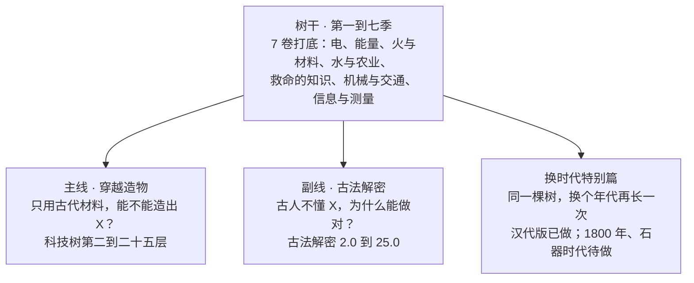
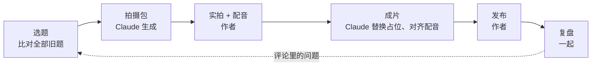

# 从零造物

> 带着现代知识穿越回古代，只用当时能找到的材料，把技术一件件重新造出来；再反过来，用现代原理解开古人早已做到的技艺。每一步都讲清楚：为什么能做成。

一个科普视频系列的完整制作记录：选题、拍摄方案、旁白、按物理公式渲染的原理动画和粗剪样片。

**在线浏览：https://bluesky-rgb.github.io/cong-ling-zao-wu/**（所有内容在网站上看，比在 GitHub 里翻文件方便）

本页分五部分：
1. 主脉络
2. 现在有什么
3. 方法和能力
4. 要准备什么、怎么继续
5. 后期方向

截至 2026 年 11 月 15 日（第五十七季）。

---

## 一、主脉络

**一个带着现代知识的人，穿越到北宋（约公元 1090 年），只用当时能找到的材料，把科技树一个节点一个节点重新点亮。**每集解锁一个节点，前面造出的东西后面接着用。

围绕这棵科技树，内容往三个方向长：



从第八季起，按「一主一副」轮流排季，每季 10 集 + 1 集特辑。

> **已知问题**：第八季以后，主线的「层」逐渐变成生活场景（浴室、玩具箱、游乐场、露营……），讲的多是现代物品的原理，「穿越者用北宋材料造出来」这条主脉络变淡了。后面再写新季时要把它拉回来，见「五、后期方向」。

## 二、现在有什么

| 内容 | 数量 | 说明 |
| --- | --- | --- |
| 季 | 57 | 全部已上线 |
| 主线 | 301 集 | `ep01` … `ep301` |
| 副线 | 259 集 | `b1` … `b259` |
| 换时代特别篇 | 5 集 | 汉代版，`h1` … `h5` |
| 每季特辑 | 57 集 | `season1` … `season57`，依赖图 + 打分表 |
| 选题库 | 565 个 | 每个都有完整拍摄本 |
| 视频文件 | 约 5370 个 | 原理动画、资料卡、问题卡、片头片尾、粗剪样片 |
| 决定记录 | 149 条 | [decisions.md](docs/decisions.md) |

**网站入口**

| 入口 | 内容 |
| --- | --- |
| [项目首页](https://bluesky-rgb.github.io/cong-ling-zao-wu/) | 总览、视频画廊、各季入口 |
| [选题详案](https://bluesky-rgb.github.io/cong-ling-zao-wu/episodes/) | 全部 565 个选题和每一季的播出计划 |
| [项目全书](https://bluesky-rgb.github.io/cong-ling-zao-wu/plan/) | 定位、方法、科技树、制作流程、风险合规、路线图 |
| [内容架构](https://bluesky-rgb.github.io/cong-ling-zao-wu/expansion/) | 第二阶段「一主一副一特别」的规则和候选选题 |
| [拍摄总排期与采购清单](https://bluesky-rgb.github.io/cong-ling-zao-wu/shooting/) | 拍摄顺序、每季排期、逐集道具；页首统计、通用工具箱和长周期实验还是按前七季算的 |
| [发布素材](https://bluesky-rgb.github.io/cong-ling-zao-wu/publish/) | 每集标题、封面文字、简介、竖屏切片脚本 |
| [待核清单](https://bluesky-rgb.github.io/cong-ling-zao-wu/checklist/) | 拍摄前要再查一遍的说法 |

## 三、方法和能力

### 一集是怎么做出来的



**每集都用同一套结构写**

- **五段结构**：问题 → 材料 → 原理 → 动手 → 解锁。
- **误解台阶**：先写出「大家以为……」，再用实验推翻，至少两级。
- **三层为什么**：现象（会发生什么）→ 原理（为什么）→ 本质（更深一层）。
- **选题五个筛子**：
  - 能接上已点亮的节点。
  - 核心实验在家能拍。
  - 安全。
  - 有反直觉。
  - 年代和数字可查证。

**每个拍摄包里有什么**

- 拍摄本网页：
  - 实验步骤、对比表、道具清单、记录表。
  - 安全提示、待核事项、资料来源。
- 原理动画：每集 2 段，用 Python 按公式渲染。
- 资料卡、问题卡、结论卡，片头片尾。
- 粗剪样片：按旁白排好的整集，实拍镜头先用占位画面。
- 每季特辑：依赖图 +「古代可行度」打分表（材料、难度、效果）。

### 这套流程能做什么，不能做什么

| Claude 能做 | 需要作者做 |
| --- | --- |
| 选题、比对旧题、查证、标出待核 | 买道具 |
| 写拍摄本、旁白、发布文案 | 实拍实验 |
| 按公式渲染原理动画、做粗剪 | 录配音 |
| 生成网站并部署到 GitHub Pages | 在各平台发布 |
| 拿到实拍素材后：改写旁白、替换占位、拼成片 | 把素材、记录表、评论数据发回来 |
| 填完打分表后：生成特辑排名和口播 | 给每集打「古代可行度」分 |

### 原则

- 实验镜头必须实拍；原理动画用代码按公式渲染；AI 视频只用于氛围镜头，发布时标注。
- 每个史实都附来源，拿不准的标「拍摄前核对」，数值标「以实测为准」。
- 明火、高温、利器、强磁铁、激光只由成年人操作；危险内容只做动画。实验食品不食用，不培养微生物，电只用 1.5–3 伏干电池，不碰市电。

## 四、要准备什么、怎么继续

**现在卡在：试播还没拍。**565 集都还停在「拍摄包」阶段。

### 下一步

1. **开工长周期实验**：要等几天到一个月才出结果，先开工。清单见[拍摄总排期](https://bluesky-rgb.github.io/cong-ling-zao-wu/shooting/)的「第 0 步」。
2. **买齐通用工具箱**：见同一页的采购清单。
3. **拍试播 3 集**：
   - 04 磁生电（钩子最强，作为模板）
   - B1 指南鱼
   - 01 摩擦起电

   每集照拍摄本拍，再录配音。
4. **把素材和记录表发给 Claude**：改写旁白、替换占位、拼成片。
5. **发布试播 3 集**：标题、封面、简介用[发布素材](https://bluesky-rgb.github.io/cong-ling-zao-wu/publish/)里写好的。
6. **一周后复盘**：
   - 把完播率、点赞、评论里的问题发给 Claude。
   - 看观众更喜欢主线还是副线。
   - 据此定后面先拍哪一季。

### 还要整理的

- [x] 仓库约 1.5 GB，超过 GitHub Pages 1 GB 的上限。已决定暂不处理：这个库是资料库和备份，视频留在原处；哪天部署失败，网站会停在上一个成功的版本，内容不会丢，到时再把视频按季分到几个新库。
- [ ] 拍摄总排期页的页首统计、通用工具箱（276 项）和长周期实验（20 项）还是按前七季算的，要按 57 季重算。
- [ ] 待核清单只汇总了第一阶段的 31 条，后面各集的「拍摄前核对」还没汇总进去。
- [ ] 项目全书的路线图停在第 6 版（10 月 26 日，七季 70 个选题），要更新到现状。
- [ ] 约 482 集里还有「拍摄前核对」标记，拍到哪集先核对哪集。
- [ ] 57 个特辑的打分表要在实拍后填写。

### 继续写新内容

在对话里说「继续」，Claude 就按「一主一副」写下一季。下一季是第五十八季，副线古法解密 26.0（决定 149）。每季写完会提交、推送，并确认 Pages 部署成功。

## 五、后期方向

三条路，按建议的先后顺序：

| 顺序 | 方向 | 现状 | 建议 |
| --- | --- | --- | --- |
| 1 | **拍摄发布** | 565 个拍摄包已备齐，试播未拍 | 最优先。没有观众，其余方向都无从验证 |
| 2 | **衍生产品** | 未开始 | 和拍摄同时准备。直接用现有内容：<br/>• 实验材料包：九成以上实验难度为「低」，在家能做<br/>• 给老师的教案：每集已有问题、误解、对比实验<br/>• 书 |
| 3 | **游戏化** | 探索中，有 5 个候选方案，未定 | 先停在设计文档和一个很小的网页原型。等视频有了观众再决定是否投入正式开发 |

**游戏化的 5 个候选方案**

- A 北宋穿越者 + 记忆宫殿
- B 实验室里的微缩世界：从石器时代起步
- C 时空书信
- D 文物修复师
- E 家族传承

共同的价值观：弄懂为什么，亲手做出来，用它帮到人。不用抽卡、体力限制、断签惩罚。

**内容本身可以继续扩展的方向**

- **换时代特别篇**：1800 年版、石器时代版，题目已列在[内容架构](https://bluesky-rgb.github.io/cong-ling-zao-wu/expansion/)页。
- **把主脉络拉回来**：让新季朝里程碑推进（有电 → 机器 → 传信 → 无线电），不再只换生活场景。
- **世界篇**：第十一季已做过罗马混凝土、古埃及搬巨石等，可以再做一季。

---

## 仓库结构

```
README.md      本页
docs/          整个网站（GitHub Pages 从 main 分支的 docs/ 发布）
  ep01/ … ep301/     主线每集的拍摄本
  b1/ … b259/        副线每集的拍摄本
  h1/ … h5/          换时代特别篇（汉代版）
  season1/ … 57/     每季特辑
  episodes/ plan/ expansion/ shooting/ publish/ checklist/   网站各入口页
  media/             渲染好的视频和封面
  decisions.md       决定记录；journey.md 探索历程；sources.md 资料来源
source/        渲染动画、粗剪和网站页面的 Python 源码
```

## 重新渲染视频

需要 Python 3、Pillow、ffmpeg 和 Noto CJK 字体。

```bash
cd source/video
python3 shot10.py            # 输出 MP4
python3 shot10.py 8          # 只渲染第 8 秒的一帧预览
```
